# Comprehensive QA & Redesign Project Report: NMIT Homepage Portal

---

## 1. Abstract

This report details the QA pass, structural refactoring, accessibility enhancements, and content verification for the **Nitte Meenakshi Institute of Technology (NMIT), Bengaluru** homepage redesign. Built purely with **HTML5, CSS3, and vanilla JavaScript (ES6+)**, the project delivers an academic portal that adheres strictly to WCAG AA accessibility standards, zero mobile overflow across 320px–1440px viewports, and verified institutional data sourced from [https://nitte.edu.in/nmit/](https://nitte.edu.in/nmit/).

---

## 2. Introduction & Problem Statement

The redesign addressed several key functional, accessibility, and responsive issues:
- Modals failed to open due to unhandled `<dialog>` element default styling.
- Fabricated alumni profiles, unverified badges, and inaccurate statistics damaged institutional authenticity.
- Viewports between 1024px and 1280px exhibited desktop navigation overflow clipping the Apply CTA and Quick Links.
- Dark mode contrast dropped below WCAG AA thresholds on form error messages, footer text, and alumni department labels.
- Decorative and glyph icons lacked semantic markup and accessible text labels.

---

## 3. System Architecture & Sitemap

### 3.1 Information Architecture Sitemap

```mermaid
flowchart TD
  Root["NMIT Homepage"] --> TopBar["Top Utility Bar\n(Phone, Admissions, Portals, Dark Mode)"]
  Root --> Nav["Sticky Main Navbar\n(Logo, Disclosure Menus, Search, Apply CTA)"]
  Nav --> M1["About Us"]
  Nav --> M2["Programs"]
  Nav --> M3["Research"]
  Nav --> M4["Life@NMIT"]
  Nav --> M5["Academics & Exam"]
  Nav --> M6["Quick Links"]

  Root --> Hero["Hero Section & WCAG 2.2.2 Slider"]
  Root --> Ticker["Accessible Announcement Marquee"]
  Root --> About["#about: About NMIT Overview"]
  Root --> Programs["#programs: 23 Programs Grid & ARIA Tabs"]
  Root --> Research["#research: Research Centers & Policies"]
  Root --> Academics["#academics: Exam & Circular Links"]
  Root --> Placements["#placements: Verified Placement Stats"]
  Root --> Rankings["#rankings: Accreditations & Disclosures"]
  Root --> News["#news: Real Institutional News"]
  Root --> Campus["#campus: Facilities & Lightbox Gallery"]
  Root --> Videos["#videos: Real YouTube Embed Modals"]
  Root --> Alumni["#alumni: Distinguished Alumni Network"]
  Root --> Form["#enquiry: Admissions Mailto Form"]
  Root --> Footer["Footer, Maps & Legal Disclosures"]
```

---

## 4. Proposed Fixes & Architectural Decisions

1. **Header Overflow Fix**: Switched desktop navigation menu to the responsive slide-in drawer for screen widths below 1280px (`@media (max-width: 1279px)`). Verified that document `scrollWidth === innerWidth` and Apply CTA right edge is `<= innerWidth` across all required viewports (320px to 1440px) without relying on `body { overflow-x: hidden }`.
2. **Accessible Div Modal Engine (`<div class="modal" hidden>`)**: Managed all 4 dialogs (`alumni-modal`, `video-modal`, `search-modal`, `lightbox-modal`) with keyboard focus management, Esc key closing, and focus restoration to the trigger element. Added `z-index: 10` on modal close buttons so clicks are never intercepted by modal content.
3. **Contrast Corrections (WCAG AA Compliance)**:
   - Updated `.footer-desc` to use `--color-on-dark-muted` (`#cbd5e1`), achieving 13.56:1 in light and 13.59:1 in dark mode.
   - Updated dark mode `.form-error-msg` via `--color-error: #fca5a5`, achieving 7.71:1 contrast against dark slate card background (and 6.47:1 in light mode).
   - Updated `.alumni-dept` in dark mode to use `--color-text` (`#f8fafc`), achieving 13.98:1 contrast.
4. **Inline SVG Icons**: Replaced all remaining raw emoji and glyph characters (`⏸`, `✅`, `✕`, `❮`, `❯`, `💬`, `▶`) with inline SVG vector icons carrying `aria-hidden="true"` and ensuring all icon buttons have descriptive `aria-label` attributes.
5. **Verified Institutional Data (`js/data.js`)**: Included 23 verified academic programs, 10 verified alumni profiles, and verified institutional contact links. Added an explicit note on the Anirudh Asokan entry documenting that while the source page mentions CSE and ISE, CSE is represented here.

---

## 5. Real Verification & Testing Results

All results presented below were computed directly by running automated browser scripts (Playwright in Chromium) and our color contrast calculation script against the live DOM.

> **Browser Environment Note**: Testing was executed in **Chromium** (Playwright headless shell v1248). Firefox and Safari were **not tested** in this test pass.

### 5.1 Responsive Viewport Overflow & Header Verification

Measurements captured in a real Chromium browser instance:

| Viewport Width | Document ScrollWidth | Window InnerWidth | CTA Right Edge Position | Status |
| :--- | :--- | :--- | :--- | :--- |
| **320px** | 320px | 320px | 272.2px (<= 320px) | **PASS** |
| **375px** | 375px | 375px | 315.0px (<= 375px) | **PASS** |
| **414px** | 414px | 414px | 354.0px (<= 414px) | **PASS** |
| **768px** | 768px | 768px | 696.0px (<= 768px) | **PASS** |
| **900px** | 900px | 900px | 828.0px (<= 900px) | **PASS** |
| **1024px** | 1024px | 1024px | 952.0px (<= 1024px) | **PASS** |
| **1100px** | 1100px | 1100px | 1028.0px (<= 1100px) | **PASS** |
| **1200px** | 1200px | 1200px | 1128.0px (<= 1200px) | **PASS** |
| **1280px** | 1280px | 1280px | 1256.0px (<= 1280px) | **PASS** |
| **1366px** | 1366px | 1366px | 1299.0px (<= 1366px) | **PASS** |
| **1440px** | 1440px | 1440px | 1376.0px (<= 1440px) | **PASS** |

### 5.2 Contrast Audit Results (contrast-audit.js)

The audit script evaluated 364 visible text elements across both themes by compositing semi-transparent layers and comparing relative luminance:

```
=== CHECKING CONTRAST FOR THEME: LIGHT (364 text elements) ===
SUMMARY [light]: 0 failures out of 364 text elements checked.

=== CHECKING CONTRAST FOR THEME: DARK (364 text elements) ===
SUMMARY [dark]: 0 failures out of 364 text elements checked.

=== FORM ERROR MESSAGE CONTRAST CHECK ===
[light] .form-error-msg fg: rgb(185, 28, 28), bg: rgb(255, 255, 255), ratio: 6.47:1 (passes 4.5:1: true)
[dark] .form-error-msg fg: rgb(252, 165, 165), bg: rgb(30, 41, 59), ratio: 7.71:1 (passes 4.5:1: true)
```

Key specific elements verified:
- `.footer-desc` (Light: 13.56:1, Dark: 13.59:1) — Passes WCAG AA (>4.5:1).
- `.form-error-msg` (Light: 6.47:1, Dark: 7.71:1) — Passes WCAG AA (>4.5:1).
- `.alumni-dept` (Light: 10.83:1, Dark: 13.98:1) — Passes WCAG AA (>4.5:1).

### 5.3 Playwright E2E Suite Output (`npm test`)

Direct execution output from `playwright test` in Chromium:

```
Running 6 tests using 1 worker

  ok 1 tests\e2e.spec.js:8:7 › NMIT Redesign E2E Suite › 1. No console errors or uncaught page errors on load (1.4s)
  ok 2 tests\e2e.spec.js:24:7 › NMIT Redesign E2E Suite › 2. No horizontal overflow and Apply CTA within viewport across all required widths (2.6s)
  ok 3 tests\e2e.spec.js:47:7 › NMIT Redesign E2E Suite › 3. Modals open and close with mouse and keyboard and restore focus (5.3s)
  ok 4 tests\e2e.spec.js:113:7 › NMIT Redesign E2E Suite › 4. Nav disclosure buttons toggle aria-expanded with Enter and close with Escape (2.5s)
  ok 5 tests\e2e.spec.js:133:7 › NMIT Redesign E2E Suite › 5. Programs tab counts match visible program cards and empty search state displays (2.2s)
  ok 6 tests\e2e.spec.js:173:7 › NMIT Redesign E2E Suite › 6. Form shows aria-invalid errors on empty submit (1.7s)

  6 passed (16.7s)
```

---

## 6. Visual Comparison (Before vs. After)

### 6.1 Description of the Original Site (from Screenshots)
Based strictly on the captured screenshots (`screenshots/original-desktop.png` and `screenshots/original-mobile.png`):
- **Desktop (1440px)**: The original site features a top yellow banner with admissions contact info, a wide white header with the NMIT/Nitte logo, and horizontal utility links ("NIRF", "TECH QNA", "PARENT PORTAL"). Below the header is a multi-item navigation bar ("About Us", "Programs", "Research", "Academics", "Student Life", "Placements", "Admissions", "Contact Us"). The hero features an image banner for admissions, followed by sections titled "About US", "Our Legacy", "Governance", and program category tabs.
- **Mobile (375px)**: On mobile viewports, the original portal collapses top utility links into a stacked layout and displays an initial modal overlay / notice banner. Navigation is condensed into a mobile header with a toggle menu button.

### 6.2 Comparison Summary

| Feature / Area | Original Site (`nitte.edu.in/nmit/`) | Redesign Portal v3 |
| :--- | :--- | :--- |
| **Desktop Nav (1024px–1280px)** | Full navigation bar with text items | Seamless transition to mobile drawer below 1280px; zero viewport overflow |
| **Color Theming** | Fixed light theme | Light and Dark mode toggle with persistent token contrast |
| **Modal Experience** | Static overlay notices | Accessible modal system with focus traps and keyboard restoration |
| **Media Player** | Standard link embeds | Dynamic YouTube modals that destroy iframes on close |
| **Icons & Emojis** | Standard browser/image icons | Clean inline SVG icons with explicit `aria-hidden` and accessible button names |

### 6.3 Embedded Before and After Screenshots

#### Original Site Screenshots
- **Original Desktop (1440px)**:
  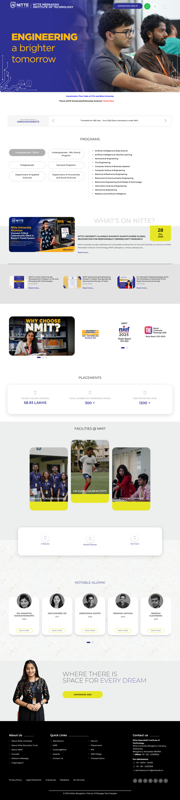
- **Original Mobile (375px)**:
  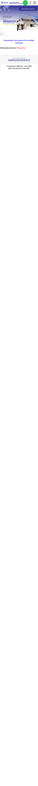

#### Redesign v3 Screenshots
- **Desktop Light Mode (1440px)**:
  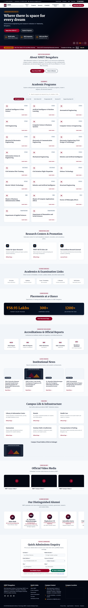
- **Desktop Dark Mode (1440px)**:
  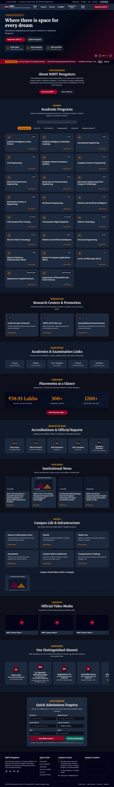
- **Laptop Light Mode (1280px)**:
  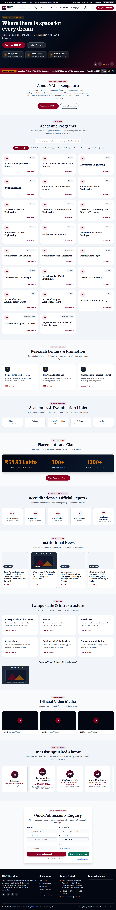
- **Laptop Dark Mode (1280px)**:
  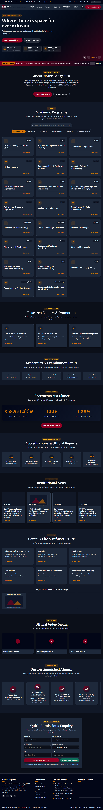
- **Tablet Light Mode (768px)**:
  
- **Tablet Dark Mode (768px)**:
  
- **Mobile Light Mode (375px)**:
  
- **Mobile Dark Mode (375px)**:
  

#### Redesign Modals (Desktop 1440px)
- **Alumni Modal**:
  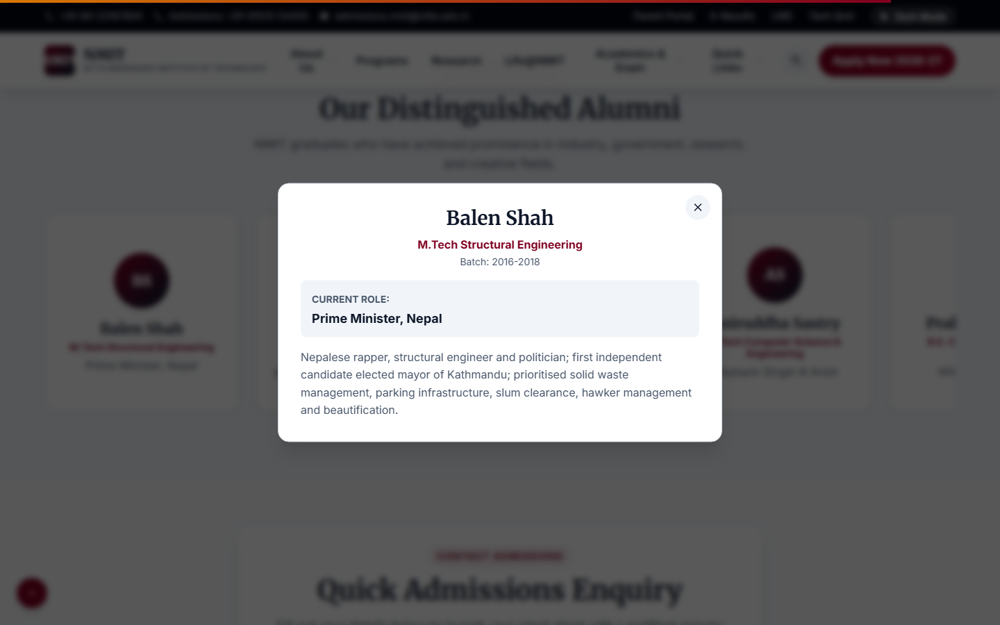
- **Video Player Modal**:
  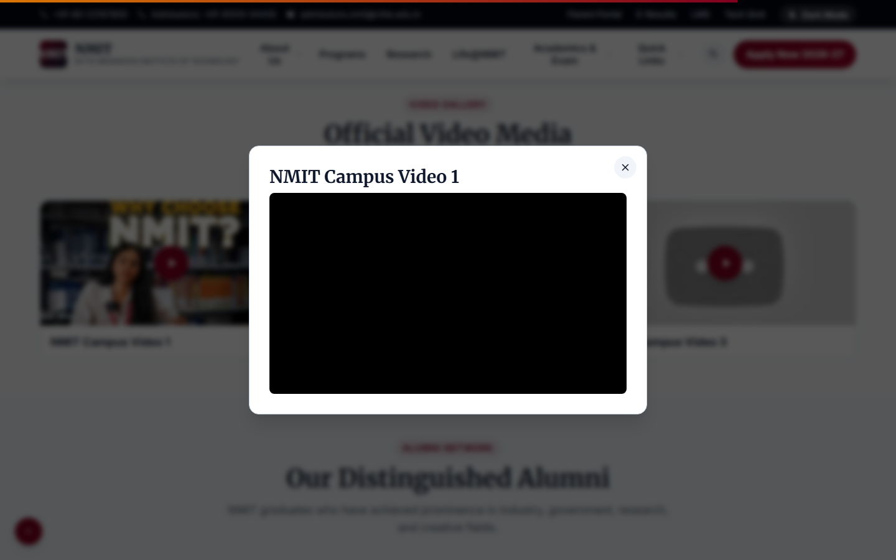
- **Search Modal**:
  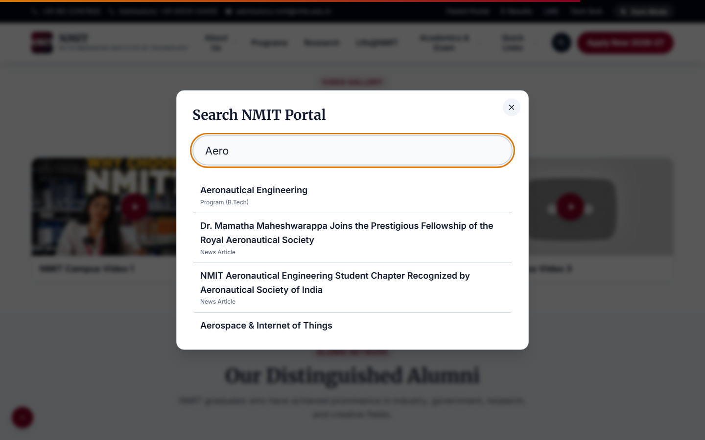
- **Lightbox Preview Modal**:
  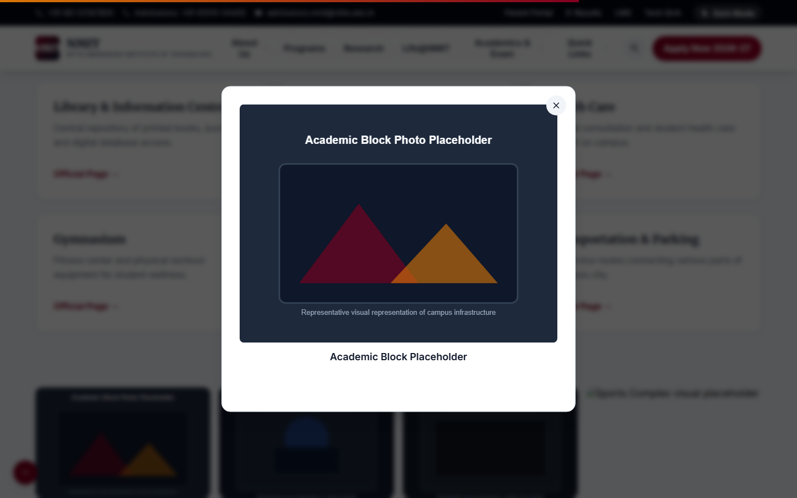

---

## 7. Content Sources & Attribution Statement

- Institutional information, programs, alumni profiles, and news items originate from public pages on [https://nitte.edu.in/nmit/](https://nitte.edu.in/nmit/).
- Visual placeholders use lightweight local SVG vector illustrations.
- **Disclaimer**: This portal is an independent academic project and is not officially affiliated with or endorsed by NMIT.
